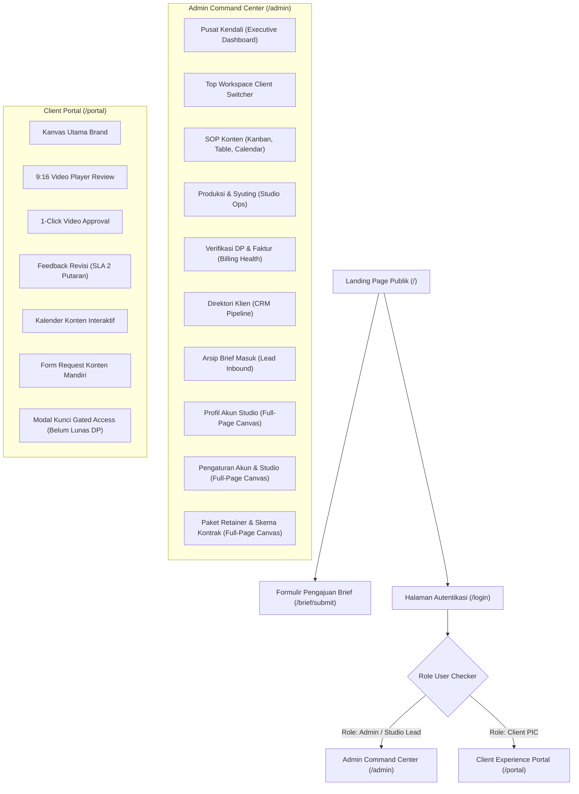
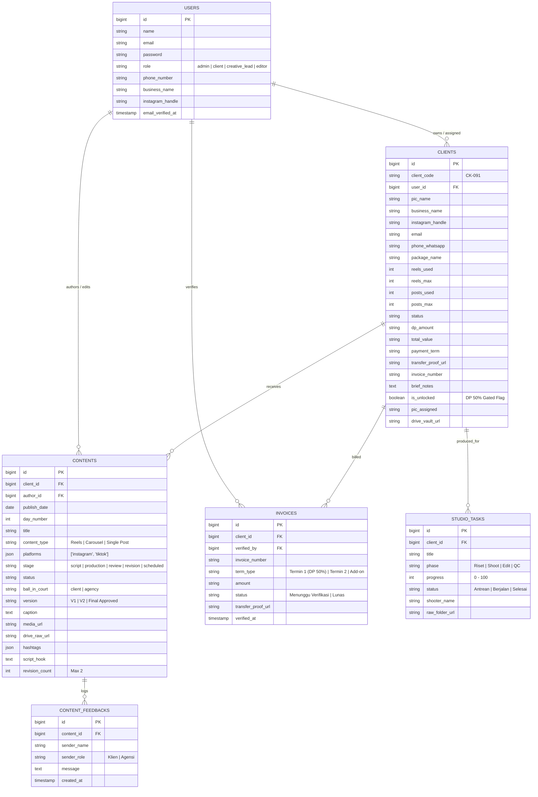

# PRODUCT REQUIREMENTS DOCUMENT (PRD)
## Cermin Kreatif — Studio Operating System & Marketing Platform
**Dokumen Spesifikasi Produk & Arsitektur Resmi**

---

### Informasi Dokumen
* **Nama Produk:** Cermin Kreatif Studio OS & Client Experience Portal
* **Versi Dokumen:** v2.4 (Terbaru — Pasca Redesign Navigasi & Kartu KPI)
* **Tanggal Rilis:** 23 November 2026
* **Status Proyek:** Aktif / Siap Produksi (Production Ready)
* **Basis Operasional:** Malang, Jawa Timur (Jangkauan Nasional: Jabodetabek, Surabaya, Bali, dll.)
* **Tech Stack:** Laravel 11/12 (PHP 8.2+), Inertia.js v2, React 19, TypeScript, Tailwind CSS, Vite, MySQL

---

## 1. Executive Summary & Visi Produk

### 1.1 Visi Produk
Cermin Kreatif adalah **Studio Operating System (Studio OS)** sekaligus **Portal Pengalaman Klien** yang dirancang khusus untuk agensi produksi video vertikal (Instagram Reels, TikTok, YouTube Shorts) berbasis sistem langganan bulanan (*monthly retainer*). 

Platform ini mentransformasi operasional agensi kreatif dari cara tradisional yang penuh gesekan (diskusi revisi berserakan di chat WhatsApp, bukti transfer manual, kuota video tercecer di spreadsheet) menjadi sistem operasi terpadu yang transparan, terukur, dan disiplin SLA.

### 1.2 Nilai Inti (*Core Value Propositions*)
1. **Transparansi SLA & Anti-Scope Creep:** Batasan ketat maksimal 2 putaran revisi draf video dan target review klien < 24 jam.
2. **Kesehatan Finansial dengan Gated Access:** Produksi dan akses fitur portal dikunci otomatis hingga pembayaran Termin 1 (DP 50%) diverifikasi oleh tim keuangan studio.
3. **Pemisahan Konteks Kerja yang Tegas:**
   - **Admin/Studio Lead:** Pusat kendali eksekutif untuk memantau kapasitas studio, cashflow MRR, bottleneck produksi, dan seluruh brand.
   - **Brand Client:** Antarmuka portal yang bersih dan fokus untuk meninjau draf video vertikal 9:16, memberikan revisi berbasis timestamp, menyetujui video tayang, dan memantau sisa kuota retainer.
4. **Desain Anti-Slop Berkualitas Tinggi:** Sepenuhnya mematuhi standar kurasi [DESIGN.md](file:///p:/Project/Web%20Development/cerminagency-laravel/DESIGN.md) (arsitektur shell statis, tipografi berbasis Inter/Plus Jakarta Sans, warna monokrom Zinc, zero emoji chrome, dan prinsip *KPIs are type, not tiles*).

---

## 2. Analisis Masalah & Solusi (Problem vs. Solution)

| Masalah Agensi Tradisional | Dampak Negatif | Solusi Cermin Kreatif Studio OS |
| :--- | :--- | :--- |
| Revisi draf video dilakukan via obrolan grup WhatsApp | Masukan terlewat, revisi tidak berujung (lingkaran setan revisi minor), timeline molor | **Review Player 9:16 Terpadu** dengan log riwayat revisi, kontrol versi (V1, V2, Final), dan kunci batas 2 kali revisi |
| Klien lambat mereview draf (> 48 jam) | Kapasitas editor menumpuk di akhir bulan, jadwal posting meleset | **Radar Botol Leher Review (>24 Jam)** dengan indikator *Ball-in-Court* dan tombol satu-klik pemicu pesan WhatsApp |
| DP 50% belum dibayar tapi tim kreatif sudah mulai syuting | Risiko piutang macet, cashflow studio terganggu | **Gated Access Engine:** Fitur produksi dan request konten terkunci secara otomatis hingga DP diverifikasi |
| Klien tidak mengetahui sisa kuota konten bulanan | Klien menuntut video melebihi nilai kontrak tanpa bersedia membayar add-on | **Visual Kuota Real-Time** (Reels & Feed Post terpakai vs kuota kontrak) di dashboard admin dan portal klien |
| Pelacakan progres syuting dan aset mentah tercecer | Tim kesulitan mencari file mentah (raw footage) dan status pascaproduksi | **Modul Produksi & Syuting** dengan 4 tahapan fase terstandarisasi dan tautan langsung ke folder Google Drive |

---

## 3. Matriks Peran Pengguna (User Personas & Role Matrix)

### 3.1 Admin / Studio Lead (e.g. Dimas Pratama)
- **Tanggung Jawab:** Pengawasan operasional studio secara menyeluruh, penetapan PIC tiap brand, verifikasi pembayaran termin faktur, pemantauan utilisasi kapasitas video, dan penetapan paket retainer.
- **Akses:** Akses penuh ke rute `/admin`, pembuatan klien baru, pengelolaan tugas syuting, verifikasi transfer bukti bayar, penyesuaian kuota add-on, dan pengelolaan pengaturan akun studio.

### 3.2 Tim Kreatif / Editor & Video Director (e.g. Farhan)
- **Tanggung Jawab:** Mengunggah draf video V1/V2, memperbarui tahapan SOP konten (Naskah → Produksi → Review → Revisi → Siap Tayang), serta mencatat status syuting harian.
- **Akses:** Manajemen konten di modul SOP Konten dan Produksi & Syuting.

### 3.3 Brand Client PIC (e.g. Budi - Maven Coffee, Sarah - Lumen Skin)
- **Tanggung Jawab:** Meninjau draf video, memberikan masukan revisi yang konstruktif, menyetujui video final (*1-Click Approve*), dan mengajukan request konten baru.
- **Akses:** Terbatas pada rute `/portal` untuk data brand miliknya sendiri. Tidak dapat melihat data brand lain atau metrik keuangan internal agensi.

---

## 4. Arsitektur Informasi & Pemetaan Rute (Routing Architecture)

---

## 5. Rincian Fitur & Spesifikasi Fungsional

### 5.1 Modul Situs Pemasaran Publik (`/` — `Welcome.tsx`)
1. **Hero Section (`HeroSection.tsx`):**
   - Menegaskan identitas agensi video spesialis Reels & TikTok.
   - Dual Call-to-Action: *Ajukan Brief Konten* (scroll halus ke formulir) dan *Lihat Paket Retainer* (buka katalog paket).
   - Indikator metrik sosial terintegrasi (jumlah produksi video bulanan & tingkat kepuasan klien).
2. **Brand Showcase & Marquee (`BrandMarquee.tsx` & `ShowreelGrid.tsx`):**
   - Marquee brand partner aktif (Maven Coffee, Lumen Skin, Arche Food, dll.).
   - Grid pameran video vertikal 9:16 interaktif dengan filter kategori (F&B, Clinic/Beauty, Lifestyle/Fashion).
3. **Pilar Studio & Deep Dives (`PillarsSection.tsx` & `FeatureDeepDivesSection.tsx`):**
   - Menjelaskan standar kerja studio: Kecepatan pengerjaan, konsistensi estetik, dan sistem operasi bebas drama revisi.
4. **Katalog Paket Retainer (`PricingSection.tsx`):**
   - **Starter Retainer:** Rp 7.500.000 / bln (5 Reels, 12 Feeds, 1x syuting studio, SLA review 48 jam).
   - **Signature Retainer:** Rp 13.500.000 / bln (15 Reels, 20 Feeds, 2x syuting studio/lokasi, SLA review 24 jam prioritas).
   - **Scale Enterprise:** Rp 25.000.000 / bln (30 Reels, 35 Feeds, 4x syuting studio/lokasi, SLA review 12 jam kilat).
   - Penjelasan transparan ketentuan termin pembayaran: 50% DP di muka sebelum pra-produksi, 50% pelunasan di akhir siklus 30 hari.
5. **Formulir Brief Interaktif (`BriefFormSection.tsx`):**
   - Multi-step input: Nama PIC, Nama Brand, Email, Nomor WhatsApp, Akun Instagram, Pilihan Paket, dan Catatan Brief.
   - Terhubung langsung ke database backend (`POST /brief/submit`) dan menyiapkan tautan percakapan WhatsApp resmi.

---

### 5.2 Modul Pusat Kendali Admin (`/admin` — `Dashboard.tsx`)

#### A. Empat Kartu Metrik KPI Eksekutif (Prinsip: *KPIs are Type, Not Tiles*)
Terletak di bagian atas dashboard [DashboardTwoExecutive.tsx](file:///p:/Project/Web%20Development/cerminagency-laravel/resources/js/Components/Admin/DashboardTwoExecutive.tsx):
1. **Brand Retainer Aktif:**
   - *Nilai:* `3 Brand` (Inter Bold 28px, tabular-nums).
   - *Konteks:* `+1 Brand vs bulan lalu`.
   - *Footer:* Daftar brand (`Maven, Lumen, Arche`) • `100% Retensi`.
2. **Monthly Retainer (MRR):**
   - *Nilai:* `Rp 44.0 Juta` (Whitespace-nowrap tanpa wrap patah).
   - *Konteks:* `+25.7% di atas target (Rp 35 Jt)`.
   - *Footer:* `Termin 1 (DP 50%) • 100% Terkumpul`.
3. **Kapasitas Produksi Video:**
   - *Nilai:* `13 / 36 Reels`.
   - *Visual Mikro:* Progress bar monokrom tipis 1.5px (`bg-zinc-900` di atas `bg-zinc-100`).
   - *Konteks:* `36% kuota terpakai • 23 sisa slot antrean`.
   - *Footer:* `Jadwal Syuting Studio • Sesuai Siklus`.
4. **Kecepatan Review Klien:**
   - *Nilai:* `18.2 Jam / draf` (Terkunci satu baris horizontal).
   - *Konteks:* `5.8 Jam lebih cepat dari SLA`.
   - *Footer:* `Batas SLA: < 24 Jam • 94% Tepat Waktu`.

#### B. Grafik Finansial & Volume Produksi
1. **Arus Kas Retainer Mingguan (`RevenueBarChart`):**
   - Komponen murni React/SVG tanpa library pihak ketiga untuk performa maksimal dan bebas bug rendering React 19.
   - Menampilkan distribusi pemasukan harian (Senin–Minggu) dengan tooltip interaktif nilai rupiah.
2. **Volume Produksi per Format (`ProductionVolumeChart`):**
   - Line chart tren pengerjaan video vertikal 9:16 dibandingkan format carousel/single post.

#### C. Tabel Faktur & Billing Health
1. **Faktur Terkini (`RecentInvoicesSection.tsx`):**
   - Menampilkan nomor invoice (`INV/2026/CK/...`), termin kontrak, nilai tagihan, dan status bukti transfer.
   - Tombol *Periksa Bukti* untuk memverifikasi tangkapan layar pembayaran secara instan via `InspectProofModal`.
2. **Kesehatan Penagihan (`BillingHealthCard.tsx`):**
   - Peringatan dini faktur DP yang belum diverifikasi agar studio tidak memulai syuting sebelum komitmen finansial aman.

#### D. Radar Botol Leher Review Klien (> 24 Jam)
- Mendeteksi draf konten yang berada di tahap `review` melebihi SLA 24 jam.
- Menampilkan nama brand, judul draf, dan durasi keterlambatan.
- Tombol aksi cepat **Ping WhatsApp** yang membuka tautan WhatsApp API dengan draf pesan sopan mengingatkan klien untuk meninjau konten.

---

### 5.3 Top Workspace Client Switcher (`AdminSidebar.tsx`)
1. **Posisi Teratas:** Terletak tepat di bawah header studio `CK Cermin Kreatif`, sebelum tombol *Jadwalkan Konten*.
2. **Desain Avatar Inisial Brand:** Kotak rounded berukuran 32x32px dengan inisial brand (contoh: `MC` untuk *Maven Coffee*, `LS` untuk *Lumen Skin*) menggunakan fungsi otomatis `getClientInitials()`.
3. **Indikator Status:** Dot hijau aktif untuk klien yang telah terverifikasi DP-nya, dan dot kuning untuk status verifikasi tertunda.
4. **Popover Navigasi:** Memungkinkan admin berpindah fokus kerja antar brand dalam 1 kali klik, memfilter konten Kanban secara otomatis, serta menyediakan tombol pendaftaran brand baru.
5. **Kebersihan Footer:** Seluruh tautan redundan (*bantuan, sampel, reset*) telah dihapus tuntas untuk menghadirkan visual bersih.

---

### 5.4 Modul SOP Konten (Multi-View Content Engine)
Mendukung 3 mode tampilan kerja terpadu:
1. **Kanban Board:**
   - 5 Kolom Tahapan: `Riset & Naskah (Script)` → `Produksi & Syuting (Production)` → `Menunggu Review Klien (Review)` → `Perbaikan Revisi (Revision)` → `Siap Tayang (Scheduled)`.
   - Papan kartu menampilkan thumbnail, durasi video, tag platform (Instagram, TikTok), dan status *Ball-in-Court* (Klien / Agensi).
2. **Table/List View:** Tampilan data padat untuk audit cepat status puluhan konten sekaligus.
3. **Calendar Grid View:** Tampilan jadwal posting harian dalam 1 bulan kalender penuh.
4. **Aturan SLA Revisi (Anti-Scope Creep):**
   - Putaran revisi tercatat otomatis (`revisionCount`).
   - Apabila telah mencapai revisi ke-2, form meminta persetujuan khusus atau diarahkan ke paket add-on kuota tambahan.

---

### 5.5 Modul Produksi & Syuting (Studio Ops)
- Pelacakan alur kerja tim lapangan dan editor studio:
  1. *Fase 1: Riset & Naskah*
  2. *Fase 2: Produksi & Shoot*
  3. *Fase 3: Penyuntingan & Desain*
  4. *Fase 4: Quality Control (QC)*
- Menyimpan nama personil penanggung jawab syuting (*shooter*), persentase kemajuan (0–100%), dan tautan langsung ke folder Google Drive tempat penyimpanan video mentah resolusi tinggi.

---

### 5.6 Modul Finansial & Gated Access Engine
1. **Penerbitan Invoice Otomatis:** Menghasilkan kode invoice berbasis tahun dan bulan berjalan (`INV/YYYY/CK/MM-XXX`).
2. **Gated Access Lock:**
   - Kolom `is_unlocked` pada entitas `clients` mengontrol aksesibilitas klien di portal.
   - Klien dengan `is_unlocked: false` hanya dapat melihat rincian tagihan invoice dan instruksi transfer bank. Fitur review dan request konten terkunci secara protektif.
3. **Add-on Quota:** Admin dapat menambahkan kuota ekstra video atau desain di luar paket langganan saat klien membutuhkan output mendadak.

---

### 5.7 Halaman Penuh Kanvas Admin (Top-Right Full-Page Views)
Sesuai arahan arsitektur, fungsi di pojok kanan atas Dashboard Header dirender sebagai **halaman penuh (*full canvas view*)** di dalam kontainer `<main>`, bukan modal pop-up:
1. **Profil Akun Studio (`ProfileView.tsx`):**
   - Informasi data pribadi Studio Lead (Nama, Email, Nomor WhatsApp, Role).
   - Form ganti kata sandi dengan validasi keamanan.
   - Manajemen sesi login aktif.
2. **Pengaturan Akun & Studio (`AccountSettingsView.tsx`):**
   - Pengaturan identitas legal studio: Nama studio, alamat studio di Malang, bio agensi.
   - Konfigurasi rekening bank penampung DP (BCA, Mandiri, nomor rekening, dan nama pemilik).
   - Konfigurasi integrasi: WhatsApp Business API Direct Gateway dan Google Drive Vault storage path.
3. **Paket Retainer & Skema Kontrak (`RetainerPlansView.tsx`):**
   - Visualisasi komparasi 3 tingkatan paket retainer (*Starter*, *Signature*, *Scale Enterprise*).
   - Spesifikasi kuota, batasan revisi, dan SLA masing-masing paket.
   - Ketentuan baku termin 50% DP dan 50% pelunasan.

---

### 5.8 Modul Portal Klien (`/portal` — `Pages/Client/Portal.tsx`)
1. **Ringkasan Kontrak Brand:**
   - Menampilkan sisa kuota Reels dan Post dalam siklus aktif berjalan.
   - Indikator status paket retainer dan nama PIC studio yang ditugaskan.
2. **Review Player 9:16 Interaktif (`ReviewModal.tsx`):**
   - Simulasi layar video vertikal smartphone untuk melihat pratinjau draf video.
   - Akses caption draf dan rekomendasi hashtag.
   - Tombol **Setujui Video (1-Click Approve):** Langsung memindahkan draf ke status `Siap Tayang` dan mencatat riwayat persetujuan.
   - Form **Minta Revisi:** Memungkinkan klien memberikan catatan perbaikan spesifik berbasis timestamp.
3. **Pusat Pengajuan Ide (`ClientRequestModal.tsx`):**
   - Klien dapat mengajukan permohonan topik konten baru secara mandiri tanpa harus mengirim pesan terpisah di WhatsApp.

---

## 6. Model Data & Skema Basis Data (Database Schema)

---

## 7. Ketentuan Aturan Bisnis & SLA (Business Rules & Constraints)

1. **Aturan Gated Access 50% DP:**
   - Tim studio dilarang memulai tahap syuting atau riset mendalam sebelum status transfer Termin 1 (DP 50%) berstatus `Lunas` (`is_unlocked = true`).
   - Portal klien hanya menampilkan tagihan invoice dan memblokir fitur review/request konten selama belum diverifikasi.
2. **Aturan Batas Revisi (Maksimal 2 Putaran):**
   - Setiap draf video hanya berhak mendapatkan maksimal 2 kali putaran revisi minor (V1 → V2).
   - Revisi di atas 2 putaran atau perubahan konsep naskah total di luar brief awal akan ditagihkan sebagai *Add-on Revision / Kuota Ekstra*.
3. **Aturan SLA Kecepatan Review Klien:**
   - Standar SLA peninjauan konten oleh klien adalah maksimal 24 jam kalender.
   - Draf yang tidak direview > 24 jam akan otomatis masuk ke dalam *Radar Botol Leher*, memicu peringatan WhatsApp, dan jadwal penayangan berhak dijadwalkan ulang oleh studio.
4. **Hak Cipta & Aset Mentah (Raw Footage):**
   - Video final yang disetujui menjadi hak milik publikasi brand klien.
   - File mentah (*raw footage*) tersimpan di Google Drive Vault studio selama masa kontrak retainer aktif.

---

## 8. Standar Desain & Kualitas Visual (Sesuai DESIGN.md)

1. **Struktur Shell Statis:**
   - Sidebar kiri berstatus statis penuh (`md:static md:h-full w-64 shrink-0 bg-white border-r border-zinc-200/80`).
   - Tidak ada elemen sidebar yang melompat (*anti-jitter*) saat scrolling; hanya kontainer `<main>` yang memiliki `overflow-y-auto`.
   - Ketinggian Header Sidebar dan Dashboard Header terkunci presisi di `h-16` (64px) untuk memastikan garis pembatas horizontal menyatu sempurna 100%.
2. **Zero Emoji Chrome:**
   - Dilarang keras menempatkan emoji mentah sistem operasi pada tombol, badge status, judul tab, atau label form.
   - Semua elemen visual wajib menggunakan tipografi presisi atau ikon Lucide SVG 14px–16px (`strokeWidth={1.5}`).
3. **Warna untuk Data, Bukan untuk Hiasan:**
   - Palet dominan: Monokrom Zinc (`zinc-50`, `zinc-100`, `zinc-200`, `zinc-900`, `zinc-950`).
   - Aksen semantik hanya untuk status data nyata:
     - Hijau Emerald (`emerald-600`): Lunas, Disetujui, SLA Aman.
     - Kuning Amber (`amber-500`): Menunggu Verifikasi, Review Tertahan, Perlu Tindakan.
     - Merah Rose (`rose-600`): Gagal, Batas Revisi Habis, Ditolak.
4. **Metrik Berbasis Tipografi (*KPIs are Type, Not Tiles*):**
   - Angka KPI ditampilkan dengan tipografi tebal (`font-inter font-bold tabular-nums`) dan satuan sejajar tanpa line-break.
   - Dilarang menggunakan kapsul permen pastel hijau berulang atau ikon pudar di pojok kartu.
5. **Kualitas Bahasa (Anti-Slop AI):**
   - Seluruh teks antarmuka menggunakan Bahasa Indonesia baku, wajar, bersahabat, dan manusiawi sesuai standar kurasi `bahasa-skills`.

---

## 9. Persyaratan Non-Fungsional (Non-Functional Requirements)

1. **Performa & Kecepatan:**
   - Skor Lighthouse Performance ≥ 90 pada mode produksi.
   - Bundle build Vite teroptimasi (waktu kompilasi ~11–16 detik untuk 3.100+ modul).
   - Transisi halaman tanpa reload penuh menggunakan arsitektur Inertia.js.
2. **Keamanan Data:**
   - Seluruh rute administratif dilindungi oleh middleware ganda `['auth', 'admin']`.
   - Kata sandi dienkripsi menggunakan algoritma bcrypt hashing.
   - Validasi data ketat pada seluruh request form input.
3. **Responsivitas Layar:**
   - Desain responsif mobile-first untuk peninjauan darurat oleh klien via smartphone.
   - Drawer navigasi mobile dengan backdrop blur halus pada viewport < 768px.
4. **Integritas Relasi Basis Data:**
   - Pemanfaatan *foreign key constraints* pada tabel konten, klien, faktur, dan umpan balik revisi untuk menjaga konsistensi data.

---

## 10. Status Implementasi Saat Ini & Rencana Pengembangan

### 10.1 Fitur yang Telah Selesai (Completed & Live)
- [x] Website Marketing Publik lengkap dengan 10+ section pameran dan formulir brief interaktif.
- [x] Dashboard Eksekutif Admin dengan 4 Kartu KPI Tipografis Padat dan Chart SVG murni.
- [x] Workspace Client Switcher terintegrasi di bagian paling atas sidebar dengan inisial dinamis.
- [x] Penghapusan elemen redundan footer sidebar (*bantuan, sampel, reset*).
- [x] 3 Halaman Penuh Kanvas untuk fungsi pojok kanan atas (*Profil, Pengaturan Akun, Paket Retainer*).
- [x] Multi-View SOP Konten (Kanban, List, Calendar) dengan batas 2 putaran revisi.
- [x] Pelacakan Produksi & Syuting Studio Ops dengan 4 fase alur kerja.
- [x] Mekanisme Gated Access finansial (kunci akses otomatis sebelum DP 50% lunas).
- [x] Portal Klien dengan Video Player 9:16 untuk persetujuan draf satu kali klik.
- [x] Database Seeder lengkap dengan data sampel realistis agensi video.

### 10.2 Rencana Pengembangan Berikutnya (Upcoming Milestones)
- [ ] **Pemberitahuan Webhook WhatsApp Otomatis:** Integrasi Fonnte / Wablas untuk mengirim notifikasi instan saat draf video V1 diunggah atau saat klien menyetujui konten.
- [ ] **Ekspor PDF Faktur & Perjanjian Kontrak:** Pembuatan file PDF resmi otomatis untuk invoice dan surat perjanjian kerja sama (*SPK*) bermaterai digital.
- [ ] **Direct Cloud Video Transcoding:** Kompresi video otomatis dan pembuatan thumbnail 9:16 langsung di cloud storage (AWS S3 / Cloudflare R2).

---
*Dokumen ini merupakan acuan resmi pengembangan produk Cermin Kreatif. Setiap perubahan arsitektur atau penambahan fitur wajib memperbarui dokumen ini.*

